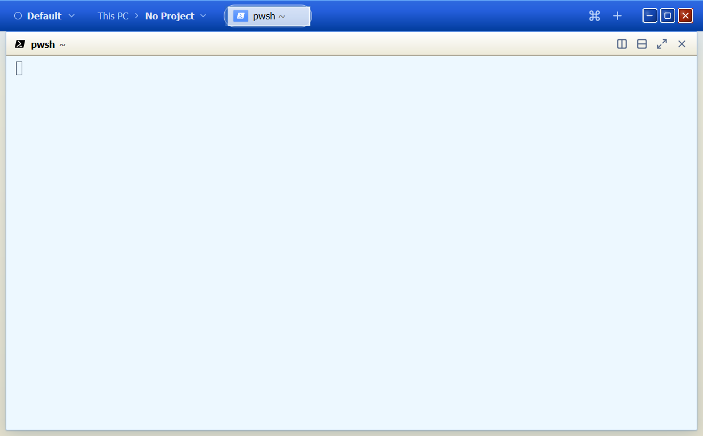
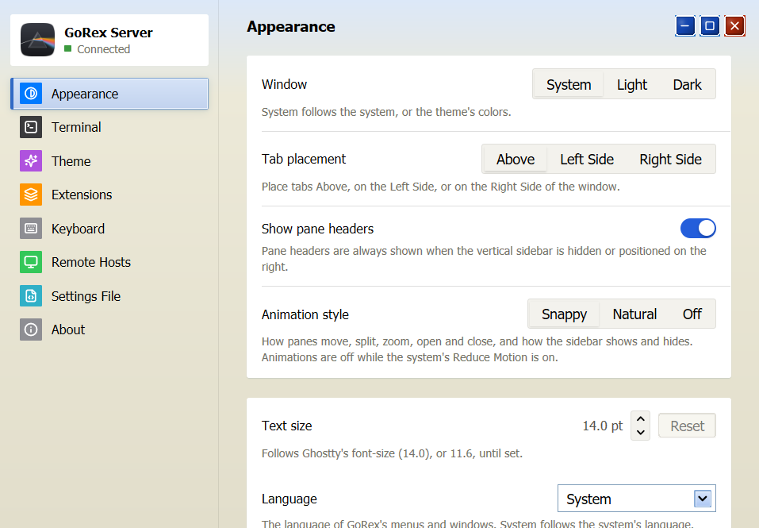

# Windows XP

A Windows XP Luna theme pack for [GoRex](https://github.com/si-mods/gorex), drawn with shader API v2:




- **Title bar & window controls**: glossy XP blue title bar with rounded blue minimize/maximize buttons and an orange-red close button.
- **Buttons**: classic XP cream-silver gradient, 1 px `#003c74` rounded border, blue inner ring on focus/primary, orange inner ring on hover, inverted bevel on press, and flat disabled look.
- **Dropdowns (`Select`)**: `#7f9db9` 1 px border on white with a blue-gradient XP dropdown button.
- **Fonts & metrics**: Tahoma / Segoe UI, subtle 1 px borders, reduced corner radius, glass off.

## Install

```sh
gorex pack install D:\repos\gorex-theme-windows-xp
```

## License

MIT, see [LICENSE](LICENSE).
